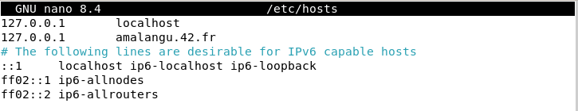

## development

starting from a fresh linux distro

### Setting QEMU/KVM or Oracle VirtualBox

Get [**Debian iso**](https://cdimage.debian.org/debian-cd/current/amd64/iso-cd/debian-13.7.0-amd64-netinst.iso) and create VM from it. Once logged in

```sh
sudo apt update && sudo apt install make git curl
```

To make the domain ("login").42.fr resolve to localhost/127.0.0.1 just add the description inside /etc/hosts

```sh
sudo nano /etc/hosts 
```

 


<div align="center"> *hosts file updated* </div>

### Debian setup

Install [**docker engine for debian**](https://docs.docker.com/engine/install/debian/) 

```sh
sudo apt remove $(dpkg --get-selections docker.io docker-compose docker-doc docker-buildx podman-docker containerd runc | cut -f1)
```

```sh
# Add Docker's official GPG key:
sudo apt update
sudo apt install ca-certificates curl
sudo install -m 0755 -d /etc/apt/keyrings
sudo curl -fsSL https://download.docker.com/linux/debian/gpg -o /etc/apt/keyrings/docker.asc
sudo chmod a+r /etc/apt/keyrings/docker.asc

# Add the repository to Apt sources:
sudo tee /etc/apt/sources.list.d/docker.sources <<EOF
Types: deb
URIs: https://download.docker.com/linux/debian
Suites: $(. /etc/os-release && echo "$VERSION_CODENAME")
Components: stable
Architectures: $(dpkg --print-architecture)
Signed-By: /etc/apt/keyrings/docker.asc
EOF

sudo apt update
```

```sh
sudo apt install docker-ce docker-ce-cli containerd.io docker-buildx-plugin docker-compose-plugin
```

- **Don't forget** [post install](https://docs.docker.com/engine/install/linux-postinstall/) and reboot/logout to apply group changes

```sh
sudo usermod -aG docker $USER && sudo reboot
```

### Clone the repository 

```sh
git clone https://github.com/toinoumlg/inception.git
```

- Then set .env.example and secrets.tofill with credidentials and params

```bash
cp srcs/.env.example srcs/.env
```

```bash
cp secrets.tofill secrets
```


