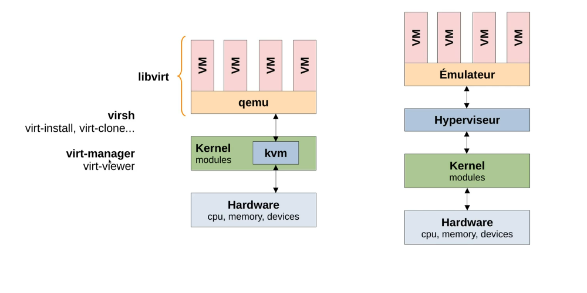
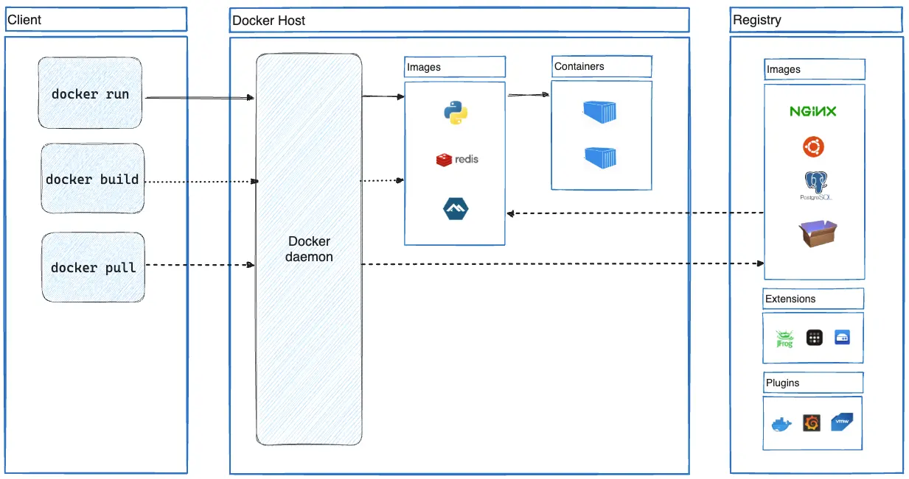
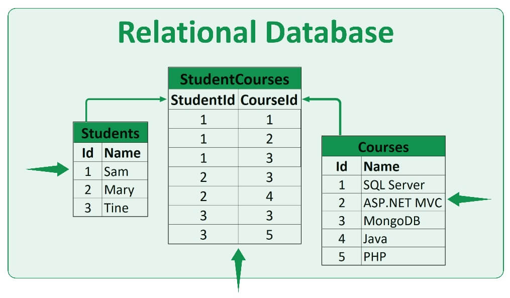

*This project has been created as part of the 42 curriculum by amalangu*
<div align="center">

# Inception 

In this project, different concept like docker, hostname mapping, nginx reverse-proxying, simple wordpress website using mariadb as its storing method. All of it run inside a virtual machine (vm). I choosed to go with QEMU/KVM combo, first to try change the way i do vm and have more performance while doing the project.


</div>

## KVM/QEMU & Libvirt

Main difference to know between using KVM/QEMU is that qemu (our emulator) talks directly to our hardware via a kernel module called KVM (Kernel-based Virtual Machine). This virtualization method is used a lot nowadays a lot of server a running throught KVM and not giving the full machine access.

<div align="center">
    

*KVM/QEMU vs VirtualBox*

</div>

## Docker

Main goal of docker is to have standardized environment via docker image and container. At first, it can seem a bit similar as using a Kernel-based virtual machines. But it's way more lightweight in term of installation alpine docker image is 5mb and dont need install params just fetch image from [docker hub](https://hub.docker.com/) is enought to have an alpine linux working in the container. Image can vary in use from barebone linux os ([alpine](https://hub.docker.com/_/alpine) or [debian](https://hub.docker.com/_/debian)) to fully integrated application like [grafana](https://hub.docker.com/r/grafana/grafana).

<div align="center">


*Docker architecture and how client talks to deamon*

</div>

different way to create a container:

|  Method  |      How      |  What |
|----------|:-------------:|------:|
| cli |  `docker run -it alpine` |creates an alpine image and open an interative terminal inside (up for until terminal close)|
| Dockerfile | `docker build [path/to/dockerfile]`  | [Dockerfile](srcs/requirements/nginx/Dockerfile) build/expand custom images on already existing image |
| docker compose | `docker compose up -d` | [compose](srcs/docker-compose.yml) creates and run all the images contained inside the compose, easier for long term setups where you want a way to store you variables |


## Mariadb

Mariadb is a relational database, that store data using rows and columns and have relation between them. Rows are defined with unique key, columns are mainly fields for what's behind that key.

<div align="center">   


*relation between unique keys, tables and rows*

</div>

It runs as its own service inside [mariadb](/srcs/requirements/mariadb/)

## Wordpress

[Wordpress](https://en.wordpress.org/) is a well known open-source content management system (CMS) based on PHP and MySQL. For CMS website, wordpress is 60% of those. Wordpress can be used for various thing, mainly blogs and shop. It offers a way to edit and pages using blocks that can be more convinient for non developper user.

Also run as its service inside [wordpress](/srcs/requirements/wordpress/)
 


# Intruction
## Fresh debian install
### Setting QEMU/KVM or Oracle VirtualBox

Get [**Debian iso**](https://cdimage.debian.org/debian-cd/current/amd64/iso-cd/debian-13.7.0-amd64-netinst.iso) and create VM from it. Once logged in

```sh
sudo apt update && sudo apt install make git curl
```

Install [**docker engine for debian**](https://docs.docker.com/engine/install/debian/) 

```sh
sudo apt remove $(dpkg --get-selections docker.io docker-compose docker-doc docker-buildx podman-docker containerd runc | cut -f1)
```

```sh
# Add Docker's official GPG key:
sudo apt update
sudo apt install ca-certificates curl
sudo install -m 0755 -d /etc/apt/keyrings
sudo curl -fsSL https://download.docker.com/linux/debian/gpg -o /etc/apt/keyrings/docker.asc
sudo chmod a+r /etc/apt/keyrings/docker.asc

# Add the repository to Apt sources:
sudo tee /etc/apt/sources.list.d/docker.sources <<EOF
Types: deb
URIs: https://download.docker.com/linux/debian
Suites: $(. /etc/os-release && echo "$VERSION_CODENAME")
Components: stable
Architectures: $(dpkg --print-architecture)
Signed-By: /etc/apt/keyrings/docker.asc
EOF

sudo apt update
```

```sh
sudo apt install docker-ce docker-ce-cli containerd.io docker-buildx-plugin docker-compose-plugin
```

- **Don't forget** [post install](https://docs.docker.com/engine/install/linux-postinstall/) and reboot/logout to apply group changes

```sh
sudo usermod -aG docker $USER && sudo reboot
```


# Links

- [Dockerfile](https://docs.docker.com/reference/dockerfile "Docker docs")
- [docker-arg-env-var](https://vsupalov.com/docker-arg-env-variable-guide/)
- [wordpress](https://wiki.alpinelinux.org/wiki/WordPress "Wiki Alpine Wordpress")
- [mariaDB](https://wiki.alpinelinux.org/wiki/MariaDB "Wiki Alpine MariaDB") and [mariaDb-install](https://mariadb.com/docs/server/clients-and-utilities/deployment-tools/mariadb-install-db )
- [Nginx](https://wiki.alpinelinux.org/wiki/Nginx "Wiki Alpine Nginx")
- [KVM/QEMU](https://www.youtube.com/watch?v=N_0SIOceugs "Youtube FR")
- [set -eou pipefail](https://gist.github.com/mohanpedala/1e2ff5661761d3abd0385e8223e16425?permalink_comment_id=3799230)
