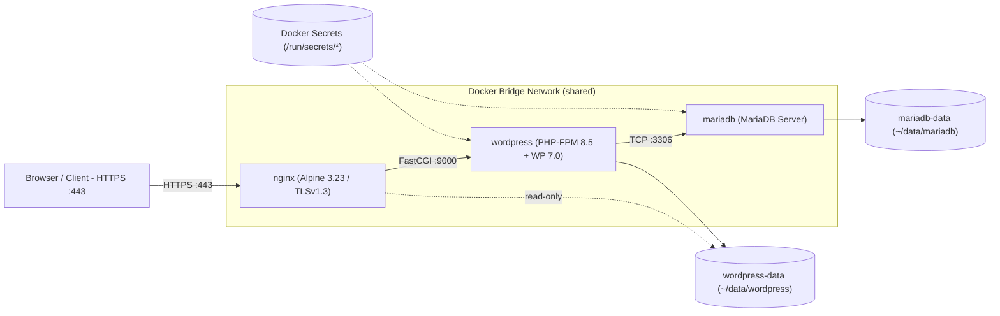
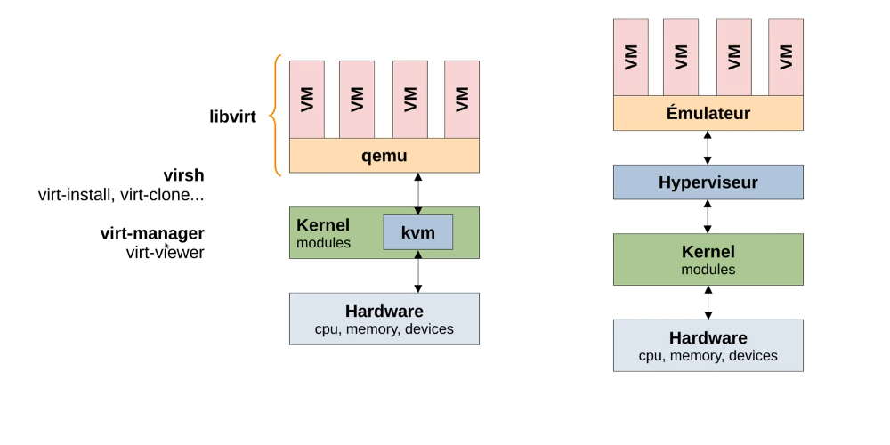
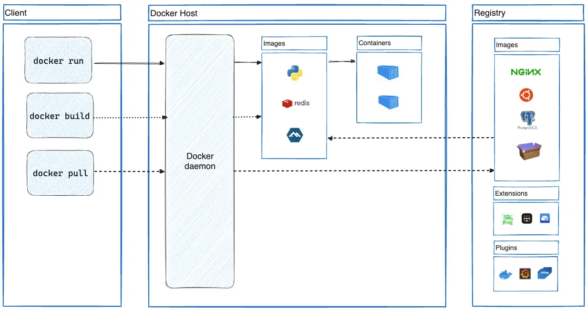
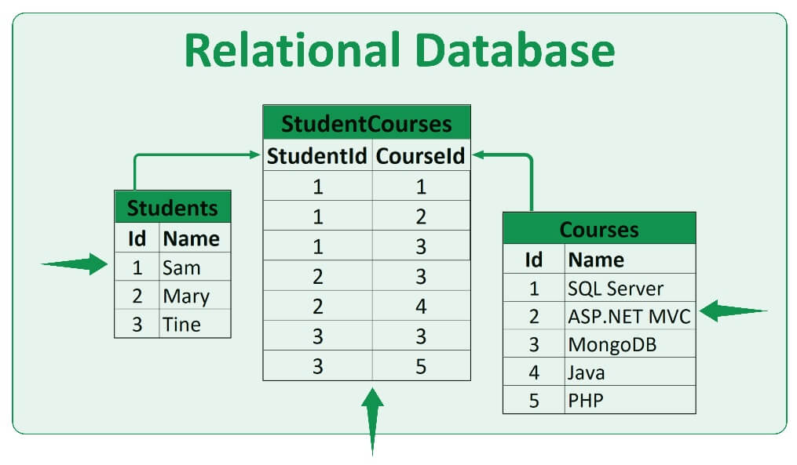

*This project has been created as part of the 42 curriculum by amalangu.*

<div align="center">

# Inception

A small-scale system administration infrastructure built with Docker and Docker Compose inside a virtual machine. It deploys a secure WordPress website backed by MariaDB and served through an Nginx reverse proxy over TLSv1.3, with each service running in its own custom-built Alpine Linux container.

</div>

---

## Description

**Inception** introduces core system administration and containerization concepts: virtualization, custom Docker image building, service orchestration with Docker Compose, hostname resolution, TLS termination, reverse proxying with Nginx, FastCGI communication with PHP-FPM, and persistent relational data storage with MariaDB.

All services are built from scratch on top of `alpine:3.23` using dedicated Dockerfiles under [`srcs/requirements/`](srcs/requirements/), orchestrated by [`srcs/docker-compose.yml`](srcs/docker-compose.yml), and managed through the root [`Makefile`](Makefile).



### KVM/QEMU & Libvirt

Everything runs inside a Debian virtual machine. I chose the **QEMU/KVM** stack (managed via Libvirt) to experiment with Linux-native virtualization and get better performance throughout the project.

The key advantage of KVM/QEMU is that QEMU (the emulator) communicates directly with the host CPU virtualization extensions through the Linux kernel module **KVM** (Kernel-based Virtual Machine), making it a Type-1-like hypervisor widely used in production servers to isolate workloads without giving guests direct full-machine access.

<div align="center">


*KVM/QEMU vs VirtualBox*

</div>

### Docker

The main goal of Docker is to provide reproducible, standardized environments through images and containers. While containers can initially feel similar to virtual machines, they share the host OS kernel and are significantly more lightweight: a base `alpine` image is only a few megabytes and requires no OS installer—fetching an image from [Docker Hub](https://hub.docker.com/) is enough to start an isolated Linux userland. Images range from minimal OS bases ([Alpine](https://hub.docker.com/_/alpine), [Debian](https://hub.docker.com/_/debian)) to full applications (such as [Grafana](https://hub.docker.com/r/grafana/grafana)).

<div align="center">


*Docker architecture and how the client talks to the daemon*

</div>

Different ways to build and run containers:

| Method | How | What |
|---|---|---|
| CLI | `docker run -it alpine` | Pulls/starts an Alpine container and opens an interactive terminal (stops when the shell exits) |
| Dockerfile | `docker build [path/to/dockerfile]` | Builds and customizes an image layer-by-layer from a base image (see [`nginx/Dockerfile`](srcs/requirements/nginx/Dockerfile)) |
| Docker Compose | `docker compose up -d` | Builds, connects, and runs multi-container stacks declaratively with shared networks, volumes, and secrets (see [`docker-compose.yml`](srcs/docker-compose.yml)) |

### Nginx

[Nginx](https://nginx.org/en/) is a high-performance web server and reverse proxy. In this stack, it acts as the **sole entry point** into the infrastructure on host port `443`:

- Terminates HTTPS connections using **TLSv1.3 only** with a self-signed X.509 RSA-2048 certificate generated on startup via OpenSSL.
- Serves static WordPress assets directly from a **read-only** mount of the shared WordPress volume.
- Forwards `.php` requests to the `wordpress` container over FastCGI (`wordpress:9000`).

It runs as its own service in [`srcs/requirements/nginx/`](srcs/requirements/nginx/).

### MariaDB

[MariaDB](https://mariadb.org/) is an open-source relational database management system built around SQL (Structured Query Language). It stores data in structured tables composed of rows and columns linked by keys and relationships.

Helpful reference: [SQL cheat-sheet](https://sql.sh/)

<div align="center">


*Relationship between unique keys, tables, and rows*

</div>

In this project, MariaDB initializes its data directory and application database/user idempotently during container bootstrap, listens only on the internal Docker bridge network, and persists all database files to the host volume. It runs as its own service in [`srcs/requirements/mariadb/`](srcs/requirements/mariadb/).

### WordPress & PHP-FPM

[WordPress](https://wordpress.org/) is an open-source Content Management System (CMS) written in PHP and backed by MySQL/MariaDB. Widely used for blogs, websites, and online stores, it provides a block-based editor that allows non-developers to manage pages and posts easily.

[PHP-FPM](https://www.php.net/manual/en/install.fpm.php) (FastCGI Process Manager) executes the WordPress PHP code and serves responses to the Nginx reverse proxy. Compared to standard embedded CGI, PHP-FPM provides managed worker pools (`pm = dynamic`), cleaner logging, and better concurrency and performance.

In this project, WordPress 7.0 is automatically configured on first boot using **WP-CLI** (creating `wp-config.php`, installing the site, and provisioning both an administrator account and an editor account). It runs as its own service in [`srcs/requirements/wordpress/`](srcs/requirements/wordpress/).

---

### Technical Design Choices

#### Virtual Machines vs Docker

| Aspect | Virtual Machines (KVM/QEMU, VirtualBox) | Docker Containers |
|---|---|---|
| **Isolation level** | Full hardware-level virtualization with a separate guest kernel | OS-level isolation using Linux namespaces and cgroups, sharing the host kernel |
| **Footprint & startup** | Gigabytes of disk/RAM; boots in tens of seconds | Megabytes per image (`alpine:3.23`); starts in seconds |
| **Use in this project** | Provides the clean Debian Linux host environment required by the subject | Runs each application service (`nginx`, `wordpress`, `mariadb`) in an isolated, reproducible container |

#### Secrets vs Environment Variables

- **Environment variables (`srcs/.env`)** are used for **non-sensitive configuration** such as `DOMAIN_NAME`, ports (`NGINX_PORT`, `WP_PORT`, `MYSQL_PORT`), database name, usernames, and email addresses. They are visible through `docker inspect` and container process environments.
- **Docker Secrets (`secrets/*` -> `/run/secrets/*`)** are used for **all passwords** (`db_root_pwd`, `db_user_pwd`, `wp_admin_pwd`, `wp_login_pwd`). Secrets are mounted as in-memory files only into the containers that need them, preventing sensitive credentials from leaking into environment dumps, shell histories, or image layers.

#### Docker Network vs Host Network

- **Host network (`network_mode: host`)** shares the host's network stack directly with containers, removing network isolation and exposing internal services (like MariaDB on port `3306` or PHP-FPM on port `9000`) to the host.
- **Dedicated Docker bridge network (`shared`)** isolates container-to-container traffic inside a private virtual subnet with built-in DNS resolution (so WordPress reaches MariaDB at `mariadb:3306` and Nginx reaches WordPress at `wordpress:9000`). Only Nginx publishes port `443` to the host, keeping the database and PHP-FPM unreachable from outside.

#### Docker Volumes vs Bind Mounts

- **Raw bind mounts** directly map an arbitrary host path into a container inside `services.<name>.volumes`, tying the service definition tightly to host directory layout.
- **Named Docker volumes** (`mariadb-data` and `wordpress-data`) are managed by Docker and referenced cleanly across services (for example, `wordpress-data` is shared read-write with `wordpress` and read-only with `nginx`). In this project, both named volumes use the `local` driver with `o: bind` targeting `~/data/mariadb` and `~/data/wordpress`, combining Docker-managed volume definitions with predictable host storage paths as required by the 42 Inception specification.

---

## Instructions

For detailed operational usage see [`USER_DOC.md`](USER_DOC.md); for full developer setup and debugging see [`DEV_DOC.md`](DEV_DOC.md).

### 1. Fresh Debian VM & Docker Installation

Download the [**Debian netinst ISO**](https://cdimage.debian.org/debian-cd/current/amd64/iso-cd/debian-13.7.0-amd64-netinst.iso) and create a VM in QEMU/KVM or VirtualBox. Once logged in, install base tools:

```sh
sudo apt update && sudo apt install -y make git curl
```

Install [**Docker Engine for Debian**](https://docs.docker.com/engine/install/debian/):

```sh
# Remove conflicting packages if present
sudo apt remove $(dpkg --get-selections docker.io docker-compose docker-doc docker-buildx podman-docker containerd runc | cut -f1)
```

```sh
# Add Docker's official GPG key
sudo apt update
sudo apt install -y ca-certificates curl
sudo install -m 0755 -d /etc/apt/keyrings
sudo curl -fsSL https://download.docker.com/linux/debian/gpg -o /etc/apt/keyrings/docker.asc
sudo chmod a+r /etc/apt/keyrings/docker.asc

# Add the Docker repository to Apt sources
sudo tee /etc/apt/sources.list.d/docker.sources <<EOF
Types: deb
URIs: https://download.docker.com/linux/debian
Suites: $(. /etc/os-release && echo "$VERSION_CODENAME")
Components: stable
Architectures: $(dpkg --print-architecture)
Signed-By: /etc/apt/keyrings/docker.asc
EOF

sudo apt update
sudo apt install -y docker-ce docker-ce-cli containerd.io docker-buildx-plugin docker-compose-plugin
```

Apply the [Linux post-install step](https://docs.docker.com/engine/install/linux-postinstall/) to run Docker without `sudo`, then reboot:

```sh
sudo usermod -aG docker $USER && sudo reboot
```

### 2. Clone and Configure the Project

```sh
git clone https://github.com/toinoumlg/inception.git
cd inception

# Create your environment file and secrets directory from the templates
cp srcs/.env.example srcs/.env
cp -r secrets.tofill secrets
```

1. Edit `srcs/.env` and replace all `CHANGE_ME` placeholders (`DOMAIN_NAME`, `LOGIN`, `WP_ADMIN_NAME`, `WP_ADMIN_MAIL`, `WP_USER_MAIL`).
2. Fill each password file inside `secrets/` (`db_root_pwd`, `db_user_pwd`, `wp_admin_pwd`, `wp_login_pwd`).
3. Map your configured `DOMAIN_NAME` to `127.0.0.1` in `/etc/hosts` (e.g., `127.0.0.1 amalangu.42.fr`).

### 3. Build and Run

```sh
make
```

This checks the configuration, creates `~/data/mariadb` and `~/data/wordpress`, builds all images, starts the containers in dependency order, and waits until every healthcheck passes. Once up, open `https://<DOMAIN_NAME>` in your browser.

Common Makefile targets:

| Command | Description |
|---|---|
| `make` / `make up` | Validate config, create host data dirs, build images, and start the stack |
| `make down` | Stop and remove containers and network (preserves host data) |
| `make stop` / `make start` | Stop or resume existing containers |
| `make ps` | Display container status and health |
| `make logs` | Follow live logs from all services |
| `make re` | Tear down and rebuild/restart containers (preserves host data) |
| `make fclean` | Tear down everything **and delete** `~/data/mariadb` and `~/data/wordpress` |

---

## Documentation

- [`USER_DOC.md`](USER_DOC.md) — End-user and administrator guide (starting/stopping services, accessing WordPress and the admin panel, managing credentials, verifying service health).
- [`DEV_DOC.md`](DEV_DOC.md) — Developer guide (setting up the environment from scratch, repository architecture, building/debugging containers, and managing persistent volumes).

---

## Resources

### References

- [Dockerfile reference](https://docs.docker.com/reference/dockerfile "Docker docs")
- [Docker Compose specification](https://docs.docker.com/reference/compose-file/)
- [Docker Secrets in Compose](https://docs.docker.com/compose/how-tos/use-secrets/)
- [Docker ARG vs ENV variable guide](https://vsupalov.com/docker-arg-env-variable-guide/)
- [Alpine Linux Wiki — WordPress](https://wiki.alpinelinux.org/wiki/WordPress "Wiki Alpine WordPress")
- [WP-CLI Commands Reference](https://developer.wordpress.org/cli/commands/)
- [FastCGI overview](https://www.ibm.com/docs/en/ibm-http-server/9.0.5?topic=applications-learn-about-fastcgi)
- [PHP-FPM documentation](https://www.php.net/manual/en/install.fpm.php)
- [Alpine Linux Wiki — MariaDB](https://wiki.alpinelinux.org/wiki/MariaDB "Wiki Alpine MariaDB") and [`mariadb-install-db` documentation](https://mariadb.com/docs/server/clients-and-utilities/deployment-tools/mariadb-install-db)
- [Alpine Linux Wiki — Nginx](https://wiki.alpinelinux.org/wiki/Nginx "Wiki Alpine Nginx")
- [KVM/QEMU explanation (FR)](https://www.youtube.com/watch?v=N_0SIOceugs "YouTube FR")
- [Writing safe shell scripts (`set -eou pipefail`)](https://gist.github.com/mohanpedala/1e2ff5661761d3abd0385e8223e16425?permalink_comment_id=3799230)

### AI Usage

AI assistance was used to proofread, structure, and expand the Markdown documentation (`README.md`, `USER_DOC.md`, and `DEV_DOC.md`) directly from the existing repository configuration, Dockerfiles, scripts, and draft notes.
